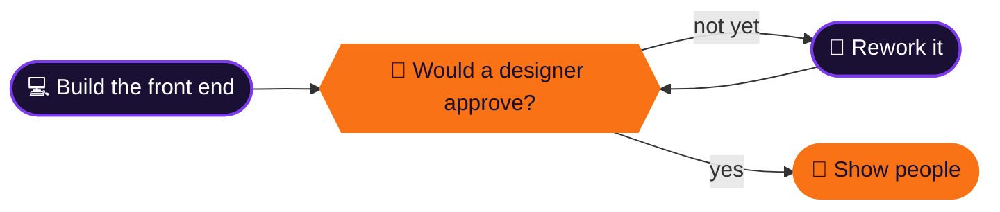

<div align="center">


<a href="https://github.com/galang-1">
  
</a>

<br/>


</div>

<br/>

<table>
<tr>
<td width="62%" valign="top">

### 👋 Hey, I'm Galang

I got into Information Systems expecting spreadsheets and process diagrams. What I found instead was the quiet, stubborn satisfaction of getting a layout to sit exactly right — and I never really left that feeling.

Somewhere between semesters, design pulled me in too. Now I think about **spacing and hierarchy** almost as much as I think about **logic and structure**.

</td>
<td width="38%" valign="top">

### 🎯 Right now

- 🎓 Information Systems student
- 🎨 Learning UI/UX
- 💻 Building the front end
- 🤝 Open to collab & freelance
- 💬 Hungry for honest feedback

</td>
</tr>
</table>

<br/>

<h2 align="center">🎨 What I obsess over</h2>

<table align="center">
<tr>
<td align="center" width="25%">
<h3>📐 Spacing</h3>
<sub>Whitespace isn't empty.<br/>It's doing a job.</sub>
</td>
<td align="center" width="25%">
<h3>🪜 Hierarchy</h3>
<sub>The eye should never<br/>have to ask where to look.</sub>
</td>
<td align="center" width="25%">
<h3>🧠 Logic</h3>
<sub>Clean structure<br/>under the pixels.</sub>
</td>
<td align="center" width="25%">
<h3>🔍 Details</h3>
<sub>That one 2px gap<br/>that looks slightly off.</sub>
</td>
</tr>
</table>

<br/>

<h2 align="center">⚡ My loop</h2>

> I build the front end, then go back and question every decision a designer would question.
> It's a slower way to work. It's also the only way I've found that produces something I actually want to show people.



<br/>

<h2 align="center">🧬 <code>galang.config.js</code></h2>

```js
const galang = {
  role: "Information Systems Student",
  focus: ["Front-end Development", "UI/UX Design"],
  obsessions: ["spacing", "hierarchy", "the 2px that looks off"],
  workflow: "build it → question every decision → rebuild",
  cameFor: "spreadsheets",
  stayedFor: "the spacing",
  openTo: ["collaboration", "freelance work", "honest feedback"],
};
```

<br/>

<h2 align="center">🛠️ Stack</h2>

<div align="center">


</div>

<br/>

<h2 align="center">📈 Activity</h2>

<div align="center">


<br/><br/>

<a href="https://github.com/galang-1?tab=repositories"></a>

</div>

<!--
<h2 align="center">🚀 Selected work</h2>
Uncomment this block and replace REPO_NAME with your best repositories.

<div align="center">

<a href="https://github.com/galang-1/REPO_NAME">
  
</a>
<a href="https://github.com/galang-1/REPO_NAME_2">
  
</a>

</div>
-->

<br/>

<div align="center">


</div>

<h2 align="center">📬 Let's talk</h2>

<div align="center">

Open to collaboration, freelance work, and honest feedback —<br/>especially the kind that makes me redo something.

<br/><br/>

<a href="https://www.linkedin.com/in/sahid-galang-fatiqin-448158342"></a>
<a href="https://YOUR-PORTFOLIO-URL"></a>
<a href="mailto:YOUR_EMAIL@example.com"></a>

<br/><br/>


</div>

<!--
Optional: custom animated sunset banner.
Only works after you upload assets/hero.svg to this repo (galang-1/galang-1).


-->
